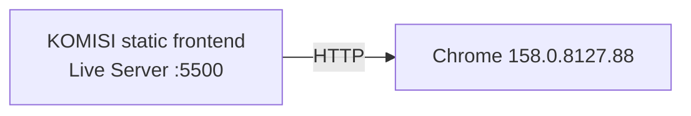

# Azure Debug Plan

> This plan is the source of truth for generating the
> VS Code debug setup in this workspace.
>
> **Status:** Implemented
> **Execution Mode:** Auto
> **Created:** 2026-11-24T00:00:00Z
> **Last Updated:** 2026-11-24T00:03:00Z

---

## Prerequisites

| Tool / Extension | Category | Service(s) | Installed | Version |
|------------------|----------|------------|-----------|---------|
| Chrome | Browser | frontend | ✅ | 158.0.8127.88 |

> The existing Live Server extension (`ms-vscode.live-server` 0.4.20) is present, and the shared browser page is served at `http://127.0.0.1:5500/`.

---

## Debug Configurations

| Generate | Debug Config Name | Service Label | Service Root | Project Type | Runtime | Version | Azure Dependencies |
|----------|--------------------|---------------|--------------|--------------|---------|---------|---------------------|
| [x] | KOMISI (Chrome debug) | KOMISI | . | frontend-spa | — | — | — |

Project Type Descriptions

| Project Type | Description |
|-------------|-------------|
| frontend-spa | Browser-based frontend; this project is framework-free static HTML, CSS, and JavaScript served with Live Server. |

> ⚠️ This is not a framework-based SPA and has no build/runtime dependency. Use the existing Live Server on port 5500 for browser debugging.

---

## Orchestrator

| Orchestrator | Container Runtime | Compose Command | Description |
|-------------|-------------------|-----------------|-------------|
| Not required | — | — | No Azure dependencies or emulator containers. |

---

## Emulators

No Azure services or local emulators are required.

---

## Architecture Diagram

The static frontend is served by Live Server and opened in Chrome for local browser debugging.

---

## Debug Configuration Checklist

Debug Configuration Checklist:
✅ KOMISI (Chrome debug) — Live Server prelaunch check passed; HTTP verification returned 200 from http://127.0.0.1:5500/.

> ✅ Final teardown — No validation processes or emulators were started; the pre-existing Live Server remains on port 5500 as required by the approved plan.

